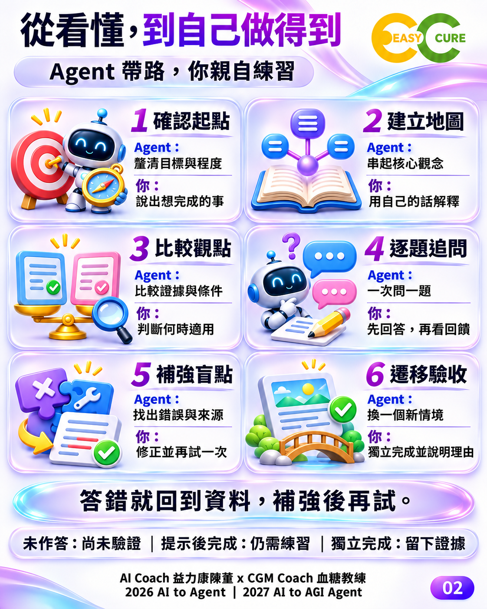
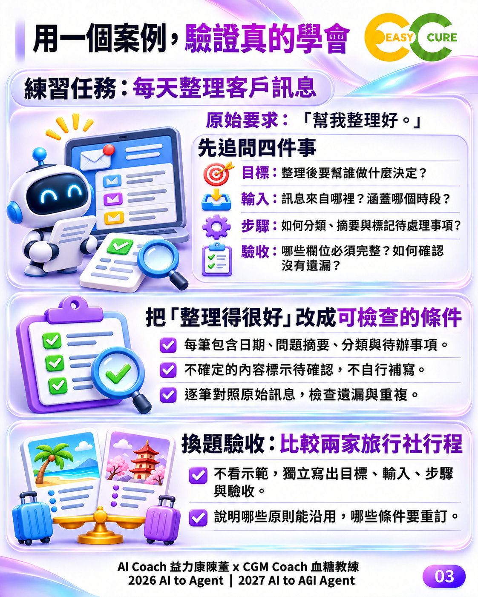

# 新手小白深度學習法

讓 Agent 引導理解、追問與補強，讓學員以實際作答與新情境應用證明學會。

專案：`ai-to-agent-beginner-deep-learning-method`；技能：`beginner-deep-learning-method`。

## 為什麼需要
資料看了很多，遇到問題卻不會用。本方法以建立地圖、比較觀點、主動作答與遷移驗收，改善只有閱讀摘要的學習過程。不保證兩天精通，也不引用未查證的 MIT 考試故事作為成效證據。

## 快速開始
使用支援自訂技能的 AI 環境，匯入 [技能資料夾](skill/beginner-deep-learning-method/SKILL.md)，依該環境的安裝方式啟用。不同產品安裝方式不同，本專案不假定單一通用安裝指令。

提供教材、文章、論文或學習主題，說：

> 啟動深度學習模式，幫我學這份資料。學完後，我想自己完成＿＿＿。

未支援技能安裝的環境，可將 SKILL.md 內容與資料一起交給 AI，要求依流程引導；此方式不代表已永久安裝。學習環境若需讀取 PDF、搜尋或保存檔案，須具備相應工具。本專案本身不需要 API Key 或程式依賴。

## 流程與驗收
確認起點 → 建立地圖 → 比較觀點 → 逐題追問 → 補強盲點 → 遷移驗收。

Agent 一次問一題，等待作答，再提供回饋。沒有作答記為未驗證；提示後完成仍需練習；新情境獨立完成才留下掌握證據。AI 不能代替學員作答後自行判定通過。

輸入：資料、目標、程度與可用時間（後兩者可省略）。
輸出：知識地圖、觀點比較、逐題練習、回饋與學習進度卡。

## 適用範圍
適合一般新手學習陌生主題與工作方法。不自動將一般摘要或翻譯任務變成完整教學；高風險決策仍須可靠來源及適當專業判斷。

## 四張圖卡

## 文件導覽
- [方法與 VAD／VAC](docs/method.md)
- [實作案例](examples/customer-messages.md)：示範資料，非真實客戶紀錄。
- [社群文章](docs/social-post.md)
- [設計規範](docs/visual-style.md)
- [驗證紀錄](docs/validation.md)
- [更新紀錄](CHANGELOG.md)、[參與方式](CONTRIBUTING.md)、[授權狀態](LICENSE)

## 版本與後續
專案版本 0.1.0，2026-11-13，首版準備稿；技能內部方法版本 1.0 是方法識別，不代表專案穩定版。尚未完成真實學員端到端測試。後續以實測改善提示與驗收規準，不承諾尚未完成的功能。

## 授權與素材
保留所有權利，見 [LICENSE](LICENSE)；目前未指定開源或開放內容授權。Logo、人物及圖卡的使用範圍須分別確認，詳見 [素材說明](assets/SOURCES.md)。已於 2026-11-13 公開並打 tag v0.1.0，未建立 GitHub Release。

## 作者
AI Coach 益力康陳董 x CGM Coach 血糖教練 | 2026 AI to Agent | 2027 AI to AGI Agent
